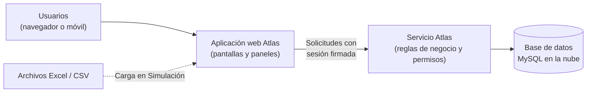

# Atlas · Resumen ejecutivo

**Plataforma de Ingeniería Logística · Farmacias Peruanas**
Fecha de corte: octubre de 2026 · Audiencia: jefaturas de Logística, Operaciones y TI

> **En una frase:** Atlas ya opera cuatro paneles útiles para el día a día logístico y es
> **apto para producción con condiciones**: antes de ampliar el número de administradores,
> hay que cerrar dos brechas de permisos y cuatro fallas puntuales.

---

## 1. Qué es Atlas

Atlas es la plataforma interna de Ingeniería Logística de Farmacias Peruanas. Reúne en una
sola aplicación web el control de accesos de los usuarios, el registro y análisis de
incidencias operativas (en almacenes y en la recepción de proveedores) y la simulación de la
carga de trabajo de los centros de distribución a partir de archivos Excel. Cada persona ve
solo los paneles y módulos que su rol le permite. El nombre es un acróstico de sus cinco ejes:
**A**nálisis · **T**razabilidad · **L**ogística · **A**utomatización · **S**incronización.

**Propuesta de valor**

- **Una sola fuente de verdad** para incidencias que hoy pueden vivir en correos y hojas sueltas.
- **Decisiones con datos:** tableros con indicadores, Pareto de causas y tendencias por centro, sistema y proveedor.
- **Planificación antes de mover gente:** simular y balancear rutas y operarios sobre datos reales antes de ejecutarlos en piso.
- **Control de acceso centralizado:** altas, roles y permisos administrados desde la misma plataforma.
- **Base lista para crecer:** cinco paneles más ya reservados para nuevas capacidades.

---

## 2. Módulos y estado

| Panel | Qué resuelve | Usuario principal | Estado |
| --- | --- | --- | --- |
| **Administración** | Alta y gestión de usuarios, roles y permisos; tablero de cuentas activas y cobertura de accesos. | Administradores de la plataforma, TI | 🟢 Operativo |
| **Bitácora** | Registro y seguimiento de incidencias operativas por centro, sistema y área; catálogos de control; tablero con indicadores y Pareto. | Ingeniería Logística, supervisores de centro | 🟢 Operativo |
| **Inbound** | Incidencias en la recepción de mercadería, por proveedor y tipo; ranking de proveedores y tendencias. | Recepción, compras, Ingeniería Logística | 🟢 Operativo |
| **Simulación** | Carga de archivos Excel/CSV, configuración de límites, operarios y rutas, balanceo de carga y tablero de resultados. | Ingeniería Logística, planificación | 🟢 Operativo |
| **Análisis** | Reservado para nuevas capacidades. | Por definir | 🚧 En construcción |
| **Trazabilidad** | Reservado para nuevas capacidades. | Por definir | 🚧 En construcción |
| **Logística** | Reservado para nuevas capacidades. | Por definir | 🚧 En construcción |
| **Automatización** | Reservado para nuevas capacidades. | Por definir | 🚧 En construcción |
| **Sincronización** | Reservado para nuevas capacidades. | Por definir | 🚧 En construcción |

**Experiencia de entrada:** una breve apertura animada con la marca ATLAS da paso a la
pantalla de acceso con la identidad de Farmacias Peruanas. Tras ingresar, un lanzador muestra
solo los paneles habilitados para cada usuario. La aplicación funciona en escritorio y móvil, con
modo claro y oscuro.

> Los paneles "en construcción" ya están visibles para cualquier usuario autenticado, pero
> solo muestran un aviso. Aún no tienen alcance funcional definido.

---

## 3. Cómo funciona

- **Todo vive en un solo servicio en la nube.** La aplicación web y el servicio se publican
  juntos en un contenedor; la base de datos es un servicio administrado aparte.
- **Ingreso:** el usuario entra con usuario y contraseña. Recibe una sesión que vence en una
  hora y que acompaña cada solicitud. Hay límites de intentos para frenar ataques de
  adivinación de contraseñas.

### Roles y permisos, en simple

| Concepto | Qué significa |
| --- | --- |
| **Permiso** | Una acción concreta: ver incidencias, crear, exportar, ver el tablero, modificar la simulación, etc. |
| **Rol** | Un paquete de permisos (por ejemplo, *Administrador*). A un usuario se le asignan uno o varios roles. |
| **Excepción** | Un permiso puntual concedido o retirado a un usuario, por encima de su rol. |
| **Doble control** | La pantalla oculta lo que el usuario no puede usar **y** el servicio vuelve a verificar el permiso en cada operación. Ocultar un botón nunca es la única barrera. |
| **Cuenta maestra protegida** | El administrador inicial no se puede borrar ni degradar, ni desde la aplicación ni directamente en la base de datos. |

---

## 4. Indicadores de calidad

Resultado de la auditoría técnica de código (solo análisis, sin cambios), traducido a impacto de negocio.

| Área | Semáforo | Lectura para negocio |
| --- | --- | --- |
| **Seguridad** | 🔴 Rojo | La base es sólida: no hay vías de inyección de datos y todas las operaciones exigen permiso. Pero un administrador con ciertos permisos podría **otorgarse más poder del que le corresponde** o **cambiar la contraseña de otro usuario**. Faltan además protecciones de navegador y un cifrado verificado hacia la base de datos. |
| **Confiabilidad** | 🟡 Ámbar | Funciona, pero hay fallas visibles: un error al cambiar la contraseña **cierra la sesión** del usuario; algunas pantallas muestran listas vacías por un permiso mal pedido; una carga de Excel lenta puede **duplicarse** si el usuario reintenta. El plan actual en la nube "se duerme" tras unos 15 minutos sin uso y tarda cerca de un minuto en despertar. |
| **Datos** | 🟡 Ámbar | Lo que envían y reciben pantalla y servicio coincide casi al 100 %. Riesgos: incidencias registradas **después de las 19:00 (hora de Lima)** pueden contarse en el día o mes siguiente en los tableros; un permiso retirado puede seguir activo unos minutos; dos personas editando lo mismo a la vez pueden pisarse cambios. |
| **Mantenibilidad** | 🟡 Ámbar | Organización por paneles clara y ordenada. Hay piezas muy grandes (sobre todo en Simulación) y mucha lógica repetida entre Bitácora e Inbound, lo que encarece cada cambio. Las mejoras de estructura ya están en curso. |
| **Pruebas** | 🔴 Rojo | Solo 9 pruebas automáticas en el servicio y ninguna en la aplicación web; no hay verificación automática en cada cambio. Hoy, cada corrección depende de pruebas manuales. |

---

## 5. Riesgos principales y plan

| # | Riesgo (en lenguaje de negocio) | Impacto si ocurre | Acción propuesta | Urgencia |
| --- | --- | --- | --- | --- |
| 1 | **Un administrador puede ampliar sus propios permisos o tomar la cuenta de otro usuario** cambiándole la contraseña. | Acceso indebido a datos y acciones; pérdida de trazabilidad de quién hizo qué. | Impedir que alguien conceda permisos que no tiene; separar el permiso de restablecer contraseñas; respetar jerarquía de roles y dejar registro. | **Inmediata**, antes de sumar administradores |
| 2 | **Equivocarse en la contraseña actual al cambiarla expulsa al usuario** de la plataforma. | Frustración, llamadas a soporte, percepción de inestabilidad. | Responder con un aviso de "contraseña incorrecta" sin cerrar la sesión. | **Inmediata** (cambio pequeño) |
| 3 | **Un permiso retirado puede seguir funcionando un tiempo**, porque la memoria interna se actualiza antes de confirmar el cambio. | Un usuario dado de baja o degradado conserva acceso unos minutos. | Actualizar la memoria interna solo después de confirmar cada cambio. | **Alta** (próximas semanas) |
| 4 | **Una carga de Excel lenta muestra error, pero el proceso sigue**; si el usuario reintenta, el registro se **duplica**. | Simulaciones duplicadas, decisiones sobre datos inflados, limpieza manual. | Mostrar "en proceso" en lugar de error y rechazar archivos ya cargados. | **Alta** (próximas semanas) |
| 5 | **Los tableros mezclan zonas horarias**: lo ocurrido de noche puede aparecer en el día o mes siguiente. | Indicadores diarios y cierres de mes desfasados; decisiones sobre cifras incorrectas. | Usar una sola zona horaria en todo el sistema. | **Alta** (próximas semanas) |

**Condición para ampliar el uso:** cerrar los riesgos 1 y 2, más el de pantallas con listas
vacías por permisos, la actualización de permisos (riesgo 3) y la carga duplicada (riesgo 4),
antes de dar acceso de administración a más personas.

---

## 6. Hoja de ruta

| Horizonte | Qué entra | Resultado esperado |
| --- | --- | --- |
| **Ahora** (0–4 semanas) | • Cerrar las brechas de permisos entre administradores y el restablecimiento de contraseñas. • Corregir el cierre de sesión al cambiar contraseña y las listas vacías por permisos. • **En curso:** reordenar la estructura del servicio por módulos con fronteras claras. • **En curso:** reorganizar la aplicación web para que cada panel sea autocontenido y comparta piezas comunes. • **En curso:** mejorar el rendimiento de la carga de archivos Excel. | Plataforma segura para sumar administradores; base técnica más ordenada. |
| **Siguiente** (1–3 meses) | • Permisos retirados que se aplican al instante. • Cargas de Excel sin duplicados ni errores engañosos. • Zona horaria única en tableros. • Primer paquete de pruebas automáticas y verificación automática en cada cambio. • Refuerzos de seguridad: cierre de sesión real en el servidor, protecciones del navegador y cifrado verificado hacia la base de datos. • Mensajes de error más claros y validaciones alineadas entre pantalla y servicio. | Indicadores confiables; cada cambio se valida solo, con menos dependencia de pruebas manuales. |
| **Después** (3–6 meses o más) | • Eliminar la lógica repetida entre Bitácora e Inbound. • Dividir las piezas más grandes de Simulación y afinar el algoritmo de balanceo. • Cambios de base de datos versionados y automáticos. • Definir y construir los paneles Análisis, Trazabilidad, Logística, Automatización y Sincronización. • Pasar a un plan en la nube sin suspensión si crece el número de usuarios. | Nuevos paneles en menos tiempo y a menor costo; plataforma lista para más usuarios. |

---

## 7. Anexo técnico (para jefaturas de TI)

### Stack y versiones

| Capa | Tecnología |
| --- | --- |
| Aplicación web | Angular 22 (componentes standalone, sin zone.js, signals), TypeScript 6, RxJS 7.8, SCSS |
| Servicio (API) | Spring Boot 4.1.2 sobre Java 25; API REST sin estado con JWT (HS256, 1 h por defecto) |
| Datos | MySQL 8 (servicio administrado en la nube en producción); Hibernate sin generación automática de esquema |
| Librerías clave | Caffeine (cachés), Apache POI 5.5.1 (lectura de Excel) |
| Despliegue | Imagen Docker única (nginx + servicio Java + supervisor); Render, 1 servicio web, plan gratuito, despliegue automático desde la rama del proyecto, chequeo de salud en `/api/health` |
| Entorno local | `docker compose` con MySQL 8.4 + la imagen de la aplicación |

### Arquitectura en viñetas

- **Servicio organizado por paneles:** módulos `auth`, `admin`, `bitacora`, `inbound`, `simulacion` y `common` (transversal: configuración, seguridad, errores, soporte web). Cada panel con capas controlador / servicio / repositorio / modelo / request / response.
- **Aplicación web** en `core` (transversal), `shared` (UI reutilizable) y `features` (autenticación, lanzador y un panel por carpeta).
- **Autorización** en dos capas: guards en rutas del frontend y `@PreAuthorize` en cada endpoint; permisos cacheados por usuario.
- **Tableros:** agregaciones SQL en paralelo sobre un ejecutor acotado, con caché por filtro invalidada al escribir.
- **Simulación:** carga multipart (.xlsx/.xls/.csv, hasta 20 MB y 100 000 filas); operaciones de balanceo serializadas por registro.
- **Configuración** solo por variables de entorno; la imagen no incluye secretos, scripts SQL ni certificados.
- **Esquema** con scripts SQL aplicados manualmente en orden (sin herramienta de migraciones).
- **Sin pipeline de CI** configurado en el repositorio.

### Referencia de riesgos a IDs de la auditoría

| Riesgo en este documento | IDs de auditoría | Prioridad |
| --- | --- | --- |
| 1. Escalada de privilegios entre administradores | SEV-01, SEV-02 (H-01, H-02) | P0 |
| 2. Cierre de sesión al cambiar contraseña | F1 | P0 |
| Listas vacías por permiso de catálogos | F2 | P0 |
| 3. Permisos revocados vigentes (caché antes del commit) | A1 | P1 |
| 4. Timeout y carga de Excel duplicada | F3 / A2 | P1 |
| 5. Zona horaria mixta en tableros | A3 / F9 | P1 |
| Rate limit de login eludible; protección por nombre | SEV-04, SEV-03 | P1 |
| Guards y `returnUrl` | FE-A1, M5 | P1 |
| Revocación JWT, CSP/HSTS, TLS a MySQL | SEV-05, SEV-06, SEV-07 | P2 |
| Errores de campo, doble aviso, validaciones | F4, F5, F6, F7 | P2 |
| Bloqueo optimista, duplicados inbound, export | A4, A5, A7 | P2 |
| Carreras en selects, canDeactivate, cachés en logout | M2, M4, FE-A4 | P2 |
| Pruebas base y CI | Sección 7 de la auditoría | P2 |
| Mono sobre JDBC, transacciones uniformes | B1, B2 | P3 |
| Clases grandes y duplicación bitácora/inbound | B3, B4 | P3 |
| Resto (OOM Excel, fórmulas CSV, contraseñas, etc.) | SEV-08 a SEV-16, A8, A10 | P3 |

**Opciones de estructura recomendadas por la auditoría:** backend **B-2** (monolito modular con
fronteras verificadas y eventos tras el commit, hexagonal solo dentro de `simulacion`);
frontend **F-2** (datos y estado por panel, más bloques reutilizables para CRUD de catálogos,
filtros y exportación). Transversal: contrato OpenAPI con tipos generados, migraciones con
Flyway y un único `.env.example` alineado con `render.yaml`.

*Fuentes: `README.md` del repositorio y el informe de auditoría técnica de Atlas.*
